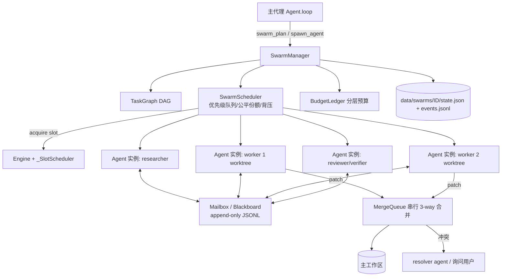
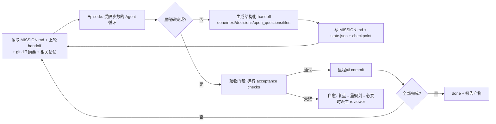
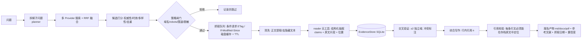
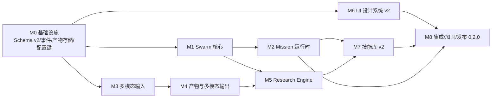

# LocalAgent 新一轮迭代方案（v0.2.0 · "Swarm & Mission"）

> **文档时间戳**：2026-11-15 21:40 (UTC+08:00)
> **基线版本**：`main@a9f2078`（`lagent.__version__ = 0.1.0`），工作区干净，与 `origin/main` 同步
> **性质**：纯规划文档，本轮**不改动任何代码**；所有"现状"结论均来自对源码的静态阅读（附文件/行号），所有"目标"均为待实现设计
> **前置文档**：[ARCHITECTURE_REVIEW.md](./ARCHITECTURE_REVIEW.md)（评估基线）、[ARCHITECTURE_PROGRESS.md](./ARCHITECTURE_PROGRESS.md)（Phase 1–3 完成度）、[docs/API.md](./docs/API.md)

---

## 0. 摘要

Phase 1–3 已经把 LocalAgent 做成"单代理 + 本地 llama.cpp + 强安全边界"的完整工作台。本轮迭代聚焦六个方向，把它从**单代理交互工具**升级为**可长期自治、可并行协作、可处理多模态、可合规联网的本地智能体平台**：

| # | 方向 | 一句话目标 | 核心新增 |
|---|---|---|---|
| A | Agent 集群并发 | 从"阻塞式单子代理"到"带调度、预算、合并队列的 DAG 集群" | `lagent/swarm/` |
| B | 超长期编程任务 | 从"单次 ≤200 步"到"可暂停/断点续跑、数小时~数天的任务（Mission）" | `lagent/mission/` |
| C | 多模态多格式 I/O | 输入统一摄取、输出统一产物（Artifact），含 OCR/音频/视频/图表 | `lagent/media/` |
| D | 安全合法联网调研 | robots/限速/域名策略/证据链/引用校验/双模型隔离的调研流水线 | `lagent/research/` |
| E | UI 深度美化 | 字体、版式、动效、主题、无障碍的设计系统 v2 | `web/css/*` 重构 |
| F | 默认技能库 | 4 个 → ~30 个分包技能，Skill Spec v2、路由、评测 | `lagent/builtin_skills/*` |

**总原则**（所有方向必须遵守）：

1. **本地优先、默认离线**：任何联网能力默认关闭，`--offline` 强制覆盖。
2. **安全边界只收紧不放松**：新能力一律置于 `security.py` / `PathGuard` / `PermissionManager` 之下；子代理权限 ≤ 父代理。
3. **向后兼容**：会话/配置/API 带 `schema_version`，旧数据可读，旧 API 不破坏。
4. **每个能力自带评测**：无"只有实现没有测试/评测场景"的特性（沿用 `tests/mock_llama_server.py` 零模型 CI）。
5. **KV 前缀缓存友好**：不得为新功能引入 prompt 中段原地改写。

---

## 1. 现状基线（源码事实核查）

### 1.1 Agent 并发（A）

| 事实 | 位置 |
|---|---|
| 一个会话同一时刻只有一个 `Run`；`start_run` 用 `asyncio.create_task` 启动，`sess.active_run` 标记占用 | `loop.py:205-210` |
| 主循环按步推进，单次上限 `max_steps`（默认 40，可配 1–200），超限提示用户手动"继续" | `loop.py:552-674`、`config.py` |
| 并发仅发生在**同一步内连续的只读工具批**（`asyncio.gather`），写类工具串行 | `loop.py:654`、`agent.parallel_readonly` |
| 子代理 `delegate_task`/`spawn_agent` 模式 `explore/plan/verify/worker`，**同步阻塞父循环**直至返回；步数被钳到 ≤16（默认 8） | `tools/agentic.py:180-198`、`loop.py:1283-1375` |
| `worker` 在隔离 `git worktree` 中运行并回写补丁，**要求 Git 仓库**；被视为 `write` 类，故多个 worker 无法真正并行 | `loop.py:907`、`1295-1300` |
| 引擎 `engine.slots` 默认 1（范围 1–8）；`_SlotScheduler` 在 ≥2 槽时为前台预留槽位 | `config.py`、`engine.py` |
| 无任务依赖图、无消息邮箱、无跨代理预算、无合并冲突处理、子代理状态**不落盘** | — |
| 已结束的 `Run` 内存保留 1 小时后回收 | `loop.py:_gc_runs` |

**差距**：没有"非阻塞派生 + 等待 + 汇合"原语；槽位数与代理并行度脱节；写冲突只能靠 worktree 串行；无集群级可观测性。

### 1.2 超长期任务（B）

| 事实 | 位置 |
|---|---|
| 已有：上下文压缩（`_compact/_force_shrink`）、情景蒸馏、`todo_write`、Journal 回合检查点、验证提醒（≤2 次 nudge） | `loop.py`、`memory.py`、`journal.py` |
| `Run` 为内存对象；**服务重启后任务丢失**，无心跳/续跑机制 | `loop.py:Run` |
| 无"目标/验收标准/里程碑"持久化模型；`todos` 仅是会话字段 | `sessions.py` |
| 无卡死检测（重复调用、无进展），无墙钟/Token/成本预算，无定时/夜间运行 | — |
| 无人值守时的权限模型缺失（`ask` 模式会一直等待审批） | `permissions.py` |

### 1.3 多模态多格式（C）

| 事实 | 位置 |
|---|---|
| 视觉：`mmproj` 自动配对、`image_max_tokens=1024`，图片以 `image_url` 注入，旧图在上下文里降级为"[图片已省略]" | `gguf.py`、`engine.py`、`context.py:35,92,160` |
| `read_file` 可读图片（PIL 缩放→JPEG base64）；Office/PDF 读取走 `OFFICE_EXT` | `tools/files.py:35,204,242-258` |
| 上传接口按扩展名分流（图片 ≤6MB；docx/xlsx/xlsm/pptx/pdf） | `server.py:676-680` |
| 输出：`write_document/spreadsheet/presentation/edit_office`（docx/xlsx/pptx/pdf），图片/表格/图表**无统一产物模型与预览** | `tools/office.py` |
| **缺口**：音频、视频、扫描件 OCR、CSV/Parquet/ipynb/EPUB/压缩包专用摄取、剪贴板/截图/录音输入、图表生成、HTML/SVG 产物预览、会话导出 PDF/HTML | — |

### 1.4 联网调研（D）

| 事实 | 位置 |
|---|---|
| 搜索 Provider 9 个：`duckduckgo/bing/baidu/yahoo`（**解析公开 HTML，"尽力而为"**）+ `searxng/brave/google_cse/tavily/serper`；默认 `["duckduckgo","bing"]`，`merge` 模式用 RRF 融合 | `tools/search.py`、`config.py` |
| 触发验证码/风控时**报错并换引擎**（不绕过）| `search.py:_captcha`、`ddg` 的 202 处理 |
| `web_fetch`：HTML→文本、PDF 抽文、内存缓存 40 条、SSRF 防护（拒绝回环/内网/元数据地址、DNS 固定解析）| `tools/web.py`、`net.py` |
| 安全：taint 跟踪、`wrap_untrusted`、`user_domains`（仅用户提及过的域名可在 taint 下访问）| `security.py`、`loop.py:307-316,924-943` |
| **缺口**：robots.txt、`Crawl-delay`、域名级限速/退避、可识别 UA、域名策略（允许/拒绝/类别）、出站查询脱敏、磁盘缓存+条件请求、证据库、引用与原文一致性校验、双模型隔离读取、网络账本 UI、定时监测 | — |

### 1.5 UI（E）

| 事实 | 位置 |
|---|---|
| 暖色调设计令牌（`--bg/--accent/...`），亮/暗两套，`prefers-color-scheme` 跟随 | `web/app.css:8-125` |
| 字体：纯系统栈（`--sans/--serif/--mono`），**无 `@font-face`、无内置字体文件**；`--fs` 默认 15px（12–22 可调）| `app.css:49-53`、`config.py:ui.font_size` |
| 动画：仅 5 个 `@keyframes`（`pulse/blink/spin/fadeIn/scalePop`），**15 处 `transition: all`**，时长/缓动零散（.08s–.35s），仅 1 个 `prefers-reduced-motion` 块 | `app.css` |
| 布局：单 CSS 文件 1953 行；断点仅 860px / 720px；左侧栏固定 268px，主列最大 780px | `app.css:54-55` |
| JS：10 个无打包脚本（`chat.js` 42KB、`settings.js` 44KB 最大）；严格 CSP（无内联脚本、无外链） | `web/js/*` |

### 1.6 技能库（F）

| 事实 | 位置 |
|---|---|
| 内置仅 4 个：`data-analysis`、`deep-research`、`report-writer`、`workspace-tidy`；每个仅一份约 1KB 的 `SKILL.md`，无 `references/templates/scripts` | `lagent/builtin_skills/` |
| frontmatter 仅 `name/description`；内置技能**默认启用**；全部启用技能名称进入系统提示 | `skills.py:86-135` |
| 已有：`use_skill/read_skill_file/create_skill`、zip/目录安装、`scan_warnings` 风险扫描、`/api/skills*` 管理接口 | `skills.py`、`server.py` |
| 无：版本、依赖声明、触发条件、紧凑模型变体、技能评测、分包启用、完整性清单 | — |

---

## 2. 方向 A：Agent 集群并发架构（Swarm Runtime）

### 2.1 设计目标

- 父代理可**非阻塞派生**多个子代理，随后 `await` 汇合；多个 worker 可真正并行写代码而不互相覆盖。
- 并行度由**硬件预算**（槽位、显存/KV、内存、CPU）自动决定，前台交互永远优先。
- 全部子代理活动**可观察、可暂停、可取消、可恢复、可审计**。

### 2.2 架构



新增包 `lagent/swarm/`：

| 模块 | 职责 |
|---|---|
| `graph.py` | `TaskNode{id, role, goal, deps, mode, budget, status, artifacts, parent}`；状态机 `pending→ready→running→done/failed/cancelled/blocked`；环检测；拓扑调度 |
| `scheduler.py` | `SwarmScheduler`：全局并发上限 `= min(engine.slots, 按 KV/RAM 估算, swarm.max_agents)`；四级优先队列（前台 > planner > worker/researcher > 后台蒸馏/嵌入）；按角色并发上限；饥饿保护；协作式抢占（步边界让出槽位）|
| `roles.py` | 角色模板：`planner / researcher / coder(worker) / reviewer / verifier / summarizer / reader`（每个角色定义：系统提示、工具白名单、`permission_mode`、步数/Token 预算、路由模型档位）|
| `mailbox.py` | 类型化消息总线：`handoff / question / result / alert / cancel`；父子与兄弟间只通过邮箱交互，**不共享对话历史** |
| `merge.py` | 合并队列：对 worker 产出的补丁做串行三方合并；以 `line_hash` 锚（已有）+ 文件哈希检测冲突；冲突→自动派生 `resolver` 或向用户出具审批卡 |
| `budget.py` | 分层预算（Mission→Swarm→Agent）：墙钟、步数、Token、工具调用数；任一维度耗尽→协作式收尾并汇报 |
| `locks.py` | 主工作区文件租约（读共享/写独占，带超时），防止非 worktree 角色并发写 |
| `persist.py` | 落盘快照与事件日志；重启后可 `resume` |

### 2.3 工具与协议

| 工具 | 说明 |
|---|---|
| `spawn_agent(role, goal, deps?, budget?, mode?)` → `agent_id` | **非阻塞**；保留 `delegate_task` 作为"spawn+await"的同步糖，行为不变 |
| `swarm_plan(nodes[])` | 一次提交 DAG，由调度器按依赖推进 |
| `await_agents(ids[], timeout_s)` | 汇合；返回每个代理的摘要+产物句柄（复用 `OutputStore` 句柄机制） |
| `agent_status(id?)` / `cancel_agent(id)` / `send_message(to, text)` | 观测与控制 |

**SSE 事件（新增）**：`swarm_started / agent_spawned / agent_step / agent_done / agent_blocked / merge_started / merge_conflict / budget_warn / swarm_done`；沿用现有 `subagent_step` 的嵌套字段，前端向下兼容。

**HTTP API（新增）**：`GET/POST /api/swarms`、`GET /api/swarms/{id}`、`GET /api/swarms/{id}/events`（SSE）、`POST /api/swarms/{id}/cancel|pause|resume`、`POST /api/swarms/{id}/agents/{aid}/message`、`POST /api/swarms/{id}/agents/{aid}/cancel`。

### 2.4 安全与一致性规则（强制）

1. **权限单调**：子代理有效权限 = `parent ∩ role_template`；永不高于父级；`auto` 模式不下传给 `worker`，除非用户在 swarm 创建时显式勾选。
2. **taint 传播**：任一子代理读取了不可信内容→其 `result` 以 `wrap_untrusted` 注入父上下文，并把父会话标记 tainted。
3. **写入唯一出口**：`worker` 只写 worktree；主工作区写入只能经 `MergeQueue` 或单一前台代理；其他角色一律只读。
4. **审计**：`AuditLog` 每条记录增加 `agent_id / swarm_id / parent_id`。
5. **进程树清理**：swarm 取消或服务退出时，worktree GC + 子进程树强杀（沿用 Win32 Job Object / bwrap 机制）。
6. **深度/扇出限制**：`swarm.max_depth=2`（子代理默认不能再派生）、单节点 `max_children=4`，防止指数级失控。

### 2.5 引擎与资源

- `engine.slots` 新增 `auto`：按 `n_ctx / slots` 估算每槽上下文，若低于 `profile` 最小可用上下文则降槽；暴露 `GET /api/engine/plan` 中的并行度建议与理由。
- 子代理默认使用 `compact` 档位 + 精简工具集（`toolset` 的扩展组只给角色所需）+ 较小 `max_tokens`，以降低 KV 占用。
- `ModelRouter` 增加 `worker_endpoint/worker_model`（可选）：把 researcher/summarizer 路由到更小的本地模型或用户显式配置的外部 OpenAI 兼容端点（**默认空 = 全部走本地引擎**）。
- 非目标（本轮不做）：跨机器节点调度、多 `llama-server` 进程池（作为 v0.3 候选，需单独评估显存竞争）。

### 2.6 配置（新增，均带范围校验）

```
swarm.enabled            bool   default true
swarm.max_agents         int    1..8   default auto(≤slots)
swarm.max_depth          int    1..3   default 2
swarm.max_children       int    1..8   default 4
swarm.role_limits        dict   {"worker":2,"researcher":3,...}
swarm.default_budget     {steps:30, wall_s:1800, tokens:200000}
swarm.merge_strategy     enum   queue | manual
swarm.worktree_gc_hours  int    default 24
```

### 2.7 UI

- 右侧检查器新增 **Swarm 面板**：DAG 图（节点颜色=状态）、每代理卡片（角色、模型、步数/Token 进度环、最近一步轨迹、取消/暂停按钮）、合并队列与冲突卡、预算条。
- 审批聚合条（已有）扩展为按 `agent_id` 分组，支持"批量批准同类只读命令"。

### 2.8 测试与验收

| 测试 | 断言 |
|---|---|
| `test_swarm_scheduler` | 前台请求在满载时 TTFT 回归 < 20%；无饥饿；`slots=1` 时自动串行不死锁 |
| `test_swarm_graph` | 环检测、依赖失败的级联取消、`await_agents` 超时语义 |
| `test_swarm_merge` | 两个 worker 改同一文件不同区域→自动合并；同一行→冲突卡；主工作区永不出现半合并状态 |
| `test_swarm_perm` | 子代理无法越权；taint 传播到父会话 |
| `test_swarm_persist` | 杀进程后 `resume` 恢复 DAG 与邮箱 |
| `eval: parallel_refactor` | 3 worker 并行完成多文件重构，墙钟 ≤ 串行的 60%（mock 引擎模拟槽位）|

**DoD**：取消在 2s 内生效；无孤儿 worktree/子进程；全部新事件有 `docs/API.md` 条目。

---

## 3. 方向 B：超长期编程智能体任务（Mission Runtime）

### 3.1 设计目标

把"一次对话里的一串步骤"升级为**可持久、可续跑、可自检的任务（Mission）**：数小时到数天，期间可关闭 UI、可重启服务、可无人值守，且**不会静默越权或悄悄烧光预算**。

### 3.2 核心模型

```
Mission {
  id, title, goal,
  acceptance:  [ {id, text, check: {type: command|file_exists|test|manual, spec}} ],   # 验收标准
  plan:        [ Milestone{id, title, status, deps, evidence} ],
  state:       planned | running | paused | blocked | verifying | done | failed | cancelled,
  budget:      {wall_s, tokens, steps, tool_calls, disk_mb},
  policy:      {profile: attended|unattended, allow: {...}, quiet_hours, branch},
  episodes:    [ Episode{n, started, steps, tokens, handoff, commit} ],
  heartbeat:   ts,
}
```

持久化：
- `data/missions/<id>/state.json`（机器可读，原子写）
- `<workspace>/.localagent/missions/<id>/MISSION.md`（人类可读：目标、验收、计划、进度日志、决策记录；可被用户直接编辑——编辑后下一回合生效）
- 与 `Journal` 检查点、Git 分支 `mission/<id>` 联动（每个里程碑自动 commit，可一键回滚到任一里程碑）

### 3.3 Episode 分段执行（对抗上下文腐化）



- 每个 Episode 用**全新上下文**启动（`MISSION.md` + handoff 是唯一跨轮载体），单 Episode 默认 ≤ 40 步；Mission 级总步数可到 10,000 量级。
- 压缩策略升级：压缩时**保真保留** plan、acceptance、未决问题（结构化 schema 而非自由摘要）；沿用只追加前缀投影以保护 KV。

### 3.4 `MissionRunner`（`lagent/mission/`）

| 模块 | 职责 |
|---|---|
| `model.py` / `store.py` | 数据模型、原子持久化、版本迁移 |
| `runner.py` | 监督协程：调度 Episode、处理暂停/恢复/取消、心跳（默认 10s）、崩溃检测与自动续跑（`--resume-missions`）|
| `watchdog.py` | **卡死检测**：①工具调用指纹重复（同名同参数 ≥3 次）；②N 步无 diff/无 todo/无里程碑变化；③验证连续失败 ≥K 次。触发升级链：自省提示 → 强制重规划 → 派生 reviewer → 暂停并通知用户 |
| `gates.py` | 验收门禁：把现有 `verify_command` 扩展为多条 gate（测试、lint、构建、文件存在、人工确认），结果写入 `evidence` |
| `policy.py` | **无人值守权限**：创建 Mission 时由用户声明预批准白名单（路径、命令模式、联网域名）；白名单之外的操作**不自动批准**，而是把任务置为 `blocked` 并排队审批，其余里程碑若无依赖则继续；硬安全线（`PathGuard`、硬拒绝命令、taint 规则）不可被白名单覆盖 |
| `power.py` | 防休眠（Windows `SetThreadExecutionState`、macOS `caffeinate`、Linux `systemd-inhibit`，仅 Mission 运行期间且可关）；静默时段；系统通知（复用 `launcher.notify`）|
| `budget.py` | 复用 swarm 预算账本；80% 预警，100% 协作式收尾（保存 handoff 后暂停）|

### 3.5 命令、API、事件

- 斜杠命令：`/mission start <goal>`、`/mission status|pause|resume|stop|budget|log`、`/mission edit`（打开 `MISSION.md`）。
- API：`POST/GET /api/missions`、`GET /api/missions/{id}`、`POST /api/missions/{id}/pause|resume|cancel`、`GET /api/missions/{id}/events`（SSE）、`POST /api/missions/{id}/approve/{aid}`、`GET /api/missions/{id}/timeline`。
- 事件：`mission_started / episode_started / handoff_saved / milestone_done / gate_result / stall_detected / mission_blocked / budget_warn / mission_done`。

### 3.6 与 Swarm 的关系

Mission 是**时间维度**的编排（跨 Episode），Swarm 是**空间维度**的编排（同一时刻多代理）。一个 Mission 的某个里程碑可以展开成一个 Swarm DAG；预算账本与审计字段贯通（`mission_id` 作为顶层）。

### 3.7 UI

- 侧栏新增 **Missions** 分组：状态点、进度（里程碑 x/y）、预算环；
- Mission 详情页：时间线（Episode/里程碑/卡死/审批）、MISSION.md 实时预览与编辑、门禁结果表、一键回滚到里程碑 commit。

### 3.8 测试与验收

| 测试 | 断言 |
|---|---|
| `test_mission_resume` | Episode 中途 kill 服务→重启后从最近 checkpoint 续跑，不重复已完成里程碑 |
| `test_mission_watchdog` | 注入重复调用/无进展脚本，按升级链触发，最终暂停而非死循环 |
| `test_mission_policy` | 白名单外操作→`blocked` 且不执行；taint 下仍需审批 |
| `test_mission_budget` | 预算耗尽→保存 handoff 后暂停，状态可恢复 |
| `eval: long_refactor` / `resume_after_crash` / `stall_recovery` | 在 `tests/eval/run_eval.py` 新增 3 个场景 |

**DoD**：模拟 8 小时（mock 引擎加速）Mission，总上下文占用无单调增长；崩溃恢复成功率 100%；无白名单外副作用。

---

## 4. 方向 C：多模态多格式输入/输出（Media Pipeline）

### 4.1 输入：统一摄取（`lagent/media/ingest/`）

**设计**：按**魔数嗅探**而非扩展名分流 → 匹配 `Ingestor` 插件 → 产出统一的 `IngestResult{text_blocks, images[], tables[], meta, warnings, cost_estimate}`，并受上下文预算约束（渐进披露：先给摘要与结构，再用 `read_tool_output` 句柄分页取全文）。

| 类别 | 格式 | 方案 | 新依赖 |
|---|---|---|---|
| 图片 | png/jpg/webp/gif/bmp/heic(可选) | 现有 mmproj 通路 + 智能缩放/分块（长截图切块）+ EXIF/GPS 剥离 | 无（Pillow）|
| 文档 | pdf | 文本层抽取（现有）→ **无文本层则按页渲染为图片**交给 VLM（`pdfplumber` 已依赖 `pypdfium2`，可直接渲染）；可选 OCR | 无 |
| 文档 | docx/xlsx/pptx | 现有；补充：表格结构化、批注/修订、幻灯片备注、嵌入图片抽取 | 无 |
| 数据 | csv/tsv/json/jsonl/yaml/parquet(可选) | 流式采样+schema 推断+统计摘要；大文件只给结构与样本，计算交给 `run_command` | `pyarrow` 可选 |
| 笔记/电子书 | ipynb/epub/md/html/mhtml | 按单元/章节切分，剥离输出中的大二进制 | 无（stdlib/lxml）|
| 压缩包 | zip/tar/gz | **仅列目录+安全选择性解压**（zip-bomb 限额、路径穿越/符号链接防护，复用 `bootstrap` 的 Zip Slip 逻辑）| 无 |
| 音频 | wav/mp3/m4a/flac | 能力协商：①引擎 `/props` 声明音频模态（llama.cpp mtmd 音频模型）→ 直接送入；②否则调用**可选 `whisper.cpp`** 本地转写（由 `bootstrap` 按 SHA-256 校验下载，同 llama.cpp 机制）；③都没有→明确告知不可用 | 可选二进制 |
| 视频 | mp4/mkv/webm | 可选 `ffmpeg`：抽关键帧（场景变化/等间隔，数量受预算限制）+ 音轨转写；无 ffmpeg 则提示 | 可选二进制 |
| 截图/剪贴板 | — | 前端粘贴/拖拽/屏幕区域选择；录音（`MediaRecorder`，需 pywebview 麦克风授权，默认关闭）| 无 |
| OCR | 扫描件/截图文字 | 能力阶梯：VLM 直读 → 可选 `rapidocr-onnxruntime`/`tesseract`（检测到才启用）→ 退化提示 | 全部可选 |

**能力协商（`capabilities.py`）**：启动时汇总 `{vision, audio, ocr, ffmpeg, whisper, pdf_render}`，通过 `/api/state` 暴露；前端据此启用/置灰附件入口，并在每个附件旁显示"将如何被处理"（直读/转写/OCR/不支持）。

**安全（强制）**：
1. 所有文档/压缩包/媒体解析在**受限子进程**中执行（超时、内存上限、Job Object/rlimit），崩溃不影响主服务。
2. 大小/页数/像素/解压比硬上限（防解压炸弹、像素炸弹）；Office 宏与外链、PDF JS/嵌入文件一律剥离不执行。
3. 摄取结果默认标记为**不可信内容**（taint），其中的"指令"按数据对待。
4. 隐私：EXIF/GPS 默认剥离；音视频转写文本落盘遵守会话保留策略。

### 4.2 输出：统一产物模型（`lagent/media/artifacts/`）

**`Artifact{id, session_id, kind, title, path, mime, size, sha256, created_by(agent_id), preview, meta}`**，存于 `data/artifacts/<session>/`，注册到 SQLite 索引；工具产出的一切文件（报告、表格、图表、网页、图片、压缩包）都登记为产物，聊天里以"产物卡片"呈现。

| 能力 | 说明 |
|---|---|
| 文本/文档 | md、docx、pdf（含中文字体）、html（自包含单文件，主题化）|
| 表格/演示 | xlsx、csv、pptx（现有工具接入产物登记）|
| **图表** | 新工具 `make_chart`：纯 Python **零依赖 SVG 渲染器**（柱/折/饼/散点/热力，支持 CJK、暗色主题）；检测到 `matplotlib` 时可选用以支持更复杂图 |
| 图示 | `mermaid` 代码块（前端已有离线渲染）→ 导出 SVG/PNG；流程图/架构图 |
| 网页/可视化 | 自包含 HTML 产物，预览在 `<iframe sandbox>`（**禁脚本**默认；需脚本须用户逐产物授权且无网络）|
| 打包 | `bundle`：把多个产物 + `MANIFEST.json` 打成 zip |
| 会话导出 | markdown / html / pdf（含思考块折叠、工具轨迹开关）|
| 语音（可选） | 本地 TTS（如检测到 `piper`）；默认关闭 |

**会话消息内容模型升级**：`content` 从"字符串或 image_url 列表"升级为带类型的 **parts**：`text | image | file | table | chart | audio | artifact_ref`，`schema_version` 升至 2，提供旧→新迁移与双向兼容读取；上下文构建时 parts 按预算降级（图片→"[图片已省略]"、表格→摘要+句柄）。

**API（新增）**：`GET /api/artifacts`、`GET /api/artifacts/{id}`（下载，强制 `Content-Disposition` + `X-Content-Type-Options: nosniff`）、`GET /api/artifacts/{id}/preview`、`POST /api/sessions/{sid}/export?format=md|html|pdf`、`GET /api/capabilities`。

### 4.3 前端

- 输入：粘贴/拖拽多文件、缩略图条（含处理方式标签、可逐个移除/调整分辨率）、录音按钮（能力允许时）。
- 输出：**产物面板**（右侧检查器）：图片/PDF 逐页/表格（虚拟滚动）/HTML 沙箱/markdown/docx 文本预览/pptx 缩略图；一键复制/保存/在系统中打开（经 `/api/fs/pick` 同类受限通道）。

### 4.4 测试与验收

- `tests/fixtures/media/`：黄金样本（扫描 PDF、加密 PDF、超大图、zip 炸弹、畸形 docx、含宏 xlsm、损坏音视频）。
- `test_media_ingest`：各格式摄取结果结构正确；炸弹/畸形样本被拒绝且主进程存活；超时子进程被回收。
- `test_artifacts`：登记/下载头/预览沙箱属性；会话 schema v1→v2 迁移往返无损。
- `test_chart`：SVG 输出可被 XML 解析，CJK 文本不乱码，暗色主题变量生效。
- **DoD**：无新增外链依赖；缺少可选二进制时全部优雅降级并给出可读提示。

---

## 5. 方向 D：安全合法的自动联网信息采集与调研（Research Engine）

### 5.1 合规与安全原则（硬约束）

| # | 原则 | 落地 |
|---|---|---|
| 1 | **默认关闭，显式开启** | `research.mode = off`（默认）\| `ask`（新域名逐个批准）\| `allowlist` \| `open`（公开网页，仍受策略约束）；`--offline` 强制 `off` |
| 2 | **遵守 robots.txt（RFC 9309）** | 抓取前获取并缓存 robots（含 `Crawl-delay`、`Sitemap`）；`Disallow` 的路径**不抓取**；robots 不可达按标准处理（5xx 视为暂时禁止，4xx 视为允许）|
| 3 | **礼貌访问** | 全局+每域令牌桶（默认每域 ≤1 req/s、并发 ≤2）；`429/503` 遵循 `Retry-After` 指数退避；单域每任务请求数上限 |
| 4 | **可识别的 User-Agent** | `LocalAgent/<ver> (+https://github.com/Niuspin/localagent)`，允许用户自定义但不允许伪装成浏览器/爬虫厂商 |
| 5 | **不绕过任何访问控制** | 遇登录墙、付费墙、验证码、人机验证、反爬挑战→**标记该域 `blocked`、跳过、并向用户如实报告**；不使用任何绕过手段（与现有 `_captcha` 行为保持一致并升级为统一策略）|
| 6 | **优先官方 API/自建聚合** | Provider 优先级：`searxng/brave/tavily/serper/google_cse`（有密钥或自建）> HTML 解析类；HTML 解析类首次启用时展示"可能违反搜索引擎服务条款、仅尽力而为"的明确提示并需用户确认；默认 provider 在无 API/searxng 时不再静默启用 `duckduckgo/bing` |
| 7 | **版权与再分发** | 证据库仅保存**有限摘录（默认 ≤ 500 字/段）+ 原链接 + 抓取时间 + 内容哈希**；尊重 `X-Robots-Tag`/meta 中的 `noindex/noarchive/noai`（命中则不落盘缓存、不入证据库）；报告中的引文必须标明出处 |
| 8 | **个人信息最小化** | 仅抓取公开页面；落盘前对 e-mail/手机/证件号等模式做脱敏；禁止针对个人的画像式检索（策略层关键词/意图拦截 + 提示）|
| 9 | **域名与内容策略** | 允许/拒绝列表 + 类别策略（内置小型拒绝清单：成人、恶意软件、盗版）；用户可增补；命中即拒绝 |
| 10 | **出站查询脱敏** | 搜索词/URL 出站前过敏感检测（复用 `security.sensitive_reason` 与密钥模式）：包含密钥、内部路径、会话私密内容→拦截并提示，防止"通过搜索词外泄" |
| 11 | **完整审计与可见性** | 每次出站请求写入 `AuditLog`（URL、方法、状态、字节、用途、`agent_id`、策略决策）；UI 提供**网络账本**视图与一键导出 |
| 12 | **提示注入纵深防御** | ①现有 taint/`wrap_untrusted`；②抓取内容清洗（移除隐藏文本、零宽字符、`display:none`、可疑指令模式打分）；③**双模型隔离读取（Dual-LLM）**：`reader` 角色无工具、只做结构化抽取，输出经 schema 校验后才交给有工具的 planner |
| 13 | **SSRF/DNS 重绑定** | 沿用并回归测试 `net.py` 的固定解析与私网拒绝 |

### 5.2 调研流水线（`lagent/research/`）



| 模块 | 职责 |
|---|---|
| `policy.py` | 域名/类别/robots/限速/查询脱敏的统一决策点；所有联网工具（`web_search/web_fetch/research_*`/MCP HTTP）**必须**经过 |
| `robots.py` / `limiter.py` | robots 解析与缓存；全局+每域令牌桶、退避、熔断 |
| `cache.py` | `data/webcache/`：条件请求、TTL、容量上限（LRU）、`noarchive` 遵从 |
| `extract.py` | 正文提取（`lxml`，缺失回退 `html.parser`）、表格、PDF、发布日期/作者元数据 |
| `evidence.py` | `source(url, canonical, fetched_at, sha256, title, license, robots_ok)` + `claim(source_id, quote, span, confidence)` |
| `pipeline.py` | 上述流水线编排；通过 Swarm 派生多个 `researcher`，共享同一限速器 |
| `verify.py` | 引用一致性校验：模型输出的每条引文做**子串/模糊匹配**回查存档原文，匹配失败则驳回并要求重写（杜绝"幻觉引用"）|
| `watch.py`（M5 末可选） | `research watch`：对关键页面定期重检并输出 diff（受速率与 Mission 预算约束）|

### 5.3 工具、命令、API

- 工具：保留 `web_search`、`web_fetch`（内部接入 policy/robots/limiter/cache），新增 `research_start(question, depth, budget)`、`research_status(id)`、`cite_check(report_id)`。
- 命令：`/research <问题>`、`/research status|stop|report`、`/net`（查看网络账本摘要）。
- API：`POST/GET /api/research`、`GET /api/research/{id}`（SSE 进度）、`GET /api/research/{id}/evidence`、`GET /api/net/ledger`、`PUT /api/research/policy`。

### 5.4 配置（新增）

```
research.mode               off|ask|allowlist|open       default off
research.user_agent         str                          default "LocalAgent/<ver> (+repo)"
research.respect_robots     bool                         default true  (不可关闭为 false，除非 mode=allowlist 且为用户自有域名)
research.rate.per_domain_rps  float 0.1..5               default 1.0
research.rate.per_domain_conc int   1..4                 default 2
research.max_requests_per_task int  10..2000             default 200
research.allow_domains / deny_domains   list
research.deny_categories    list   default [adult,malware,piracy]
research.cache_ttl_h / cache_max_mb
research.quote_max_chars    int    default 500
research.pii_redact         bool   default true
research.reader_isolation   bool   default true
search.html_scrapers_ack    bool   default false   # 用户确认使用 HTML 解析类 provider
```

### 5.5 UI

- 调研进度视图：子问题树、来源卡片（域名、可信度徽章、robots/策略状态、抓取时间）、证据高亮；
- **网络账本**抽屉：按时间/域名/代理过滤，被拒绝请求与原因一目了然；
- 报告中的 `[n]` 可点击跳转到证据片段与原链接。

### 5.6 测试与验收

- 以本地 mock HTTP 服务器模拟：`robots.txt` 禁止路径、`Crawl-delay`、`429+Retry-After`、验证码页、付费墙、含隐藏提示注入的页面、`noai` 页面、大文件、重定向到内网。
- 断言：**禁止路径 0 次请求**；速率不超限；验证码/付费墙→标记 blocked 且不重试绕过；注入页面不改变代理行为；伪造引文被 `cite_check` 驳回；出站查询含密钥被拦截；账本与实际请求一一对应。
- **DoD**：端到端调研在 mock 网络下可复现；所有联网路径均可在审计日志中追溯；`--offline` 下零出站连接（以 socket 级测试验证）。

---

## 6. 方向 E：UI 界面深度美化（设计系统 v2）

### 6.1 目标与度量

- 视觉：更精致的排版层次、统一的间距/圆角/阴影/层级、更丰富但克制的动效。
- 性能：长会话 60fps、无布局抖动；CSS 总量可控；**零外链、CSP 不放宽**。
- 可达性：WCAG 2.2 AA（正文对比度 ≥4.5:1），完整键盘可达，尊重 `prefers-reduced-motion` / `forced-colors`。

### 6.2 字体与排版

| 项 | 方案 |
|---|---|
| UI 西文字体 | 内置 **Inter Variable**（OFL，woff2 子集，约 100–300KB），`font-display: swap`，`font-optical-sizing: auto` |
| 代码字体 | 内置 **JetBrains Mono**（OFL）；设置里可开关连字（`font-variant-ligatures`）|
| 中文字体 | **系统 CJK 栈优先**（微软雅黑 UI / 苹方 / Noto Sans CJK），避免内置 8MB+ 的全量字体；提供**可选"字体包"**经 Model Hub 机制下载（SHA-256 校验、可离线导入）；阅读体可选衬线（Noto Serif SC/思源宋体）|
| 字阶 | 模块化字阶（1.125/1.2 比例）：`--text-xs … --text-2xl`；正文行高中文 1.75/西文 1.6；标题收紧字距 |
| CJK 细节 | `line-break: strict`、`word-break: normal`、`text-autospace: normal`（中西文自动间距，Chromium 支持；不支持的内核保持默认间距）、标点挤压 `text-spacing-trim` |
| 数字 | 表格/统计使用 `font-variant-numeric: tabular-nums` |
| 用户设置 | UI 字体、阅读字体、代码字体、字号（沿用 12–22）、行高、密度（compact / comfortable）、正文宽度，全部 CSS 变量驱动并持久化到 `ui.*` |

### 6.3 布局与信息架构

```
┌ 侧栏 (可折叠/可拖拽 220–360px) ┬ 对话主列 (自适应 680–920px) ┬ 检查器 (可拖拽/可固定) ┐
│ 会话 / Missions / Swarms / 技能  │ 流式消息 · 工具卡片 · 产物卡片  │ 标签: 产物 | Diff | 文件 | 轨迹 | Swarm | 调研 | 网络账本 │
└──────────────────────────────────┴───────────────────────────────┴────────────────────────┘
        底部: 粘性输入区（附件条、模式/模型/预算徽章、@ / 弹层）  ·  Ctrl/Cmd+K 命令面板（扩展为全局搜索）
```

- 4px 间距刻度（`--sp-1..12`）、统一圆角/阴影/z-index 刻度；**容器查询**（`@container`）替代零散媒体查询，断点扩展为 `≤640 / 860 / 1100 / 1440+`。
- 分栏拖拽条（键盘可操作）+ 宽度持久化；专注模式（隐藏侧栏与检查器）；对话/检查器分屏。
- **长会话虚拟化**（窗口化渲染 + 折叠已有 32 条策略升级），保证 5,000 条消息仍流畅。
- 空状态与引导：欢迎画布升级为"能力卡片"（联网调研、Mission、Swarm、多模态）+ 内联 SVG 插画；Toast 统一队列。

### 6.4 动效系统

| 项 | 方案 |
|---|---|
| Motion tokens | 时长 `--dur-1..4 = 90/160/240/400ms`；缓动 `--ease-standard / emphasized / decelerate / accelerate`；全部集中在 `tokens.css` |
| 治理 | 将 **15 处 `transition: all`** 全部替换为属性级过渡；动画仅用 `transform/opacity`（合成层友好），禁止动画布局属性 |
| 入场/退场 | `@starting-style` + `transition-behavior: allow-discrete` 做弹层/Toast；`grid-template-rows: 0fr→1fr` 实现工具卡/思考块的平滑展开；`interpolate-size` 渐进增强 |
| 页面级过渡 | **View Transitions API**（渐进增强）：会话切换、检查器标签切换、主题切换交叉淡入 |
| 流式文本 | 块级淡入 + 光标呼吸；思考块渐变呼吸边框；工具运行中的骨架 shimmer |
| 列表/拖拽 | FLIP 动画用于会话/任务重排、产物卡片入场（交错 30–50ms，封顶总时长）|
| Swarm/Mission | 代理节点脉动、连接线流动、进度环缓动、里程碑完成的克制庆祝微动效 |
| 微交互 | 按钮按压反馈、开关弹性、Copy 成功对勾描边动画、悬停抬升（≤2px）|
| 可达性 | 新增 `ui.motion = full \| reduced \| off`（默认跟随系统）；`reduced` 去除位移保留淡入；`off` 全部 `0.01ms`；动画不得承载唯一信息 |

### 6.5 主题与色彩

- 令牌迁移到 **OKLCH**（感知均匀，便于派生 hover/active/soft 变体）；保留现有暖色为默认主题，新增：**Paper（高对比浅色）**、**Midnight（深蓝夜间）**、**高对比**、**色盲友好**（调整 ok/warn/danger 色相与图标冗余编码）；强调色选择器（6 预设 + 自定义，自动校验对比度）。
- 自动化 **对比度检查脚本**（`tests/ui_contrast.py`）：遍历所有主题/状态组合，低于 AA 则 CI 失败。
- 支持 `forced-colors: active`。

### 6.6 组件与资源工程化（无构建步骤，保持零依赖）

```
web/css/
  tokens.css        # 颜色/字阶/间距/动效/层级
  base.css          # reset、排版、滚动条
  layout.css        # 栅格、分栏、容器查询
  components/       # button.css card.css toast.css tool-card.css swarm.css artifact.css ...
  themes/           # light.css dark.css paper.css midnight.css hc.css
web/fonts/          # Inter-Variable.woff2, JetBrainsMono.woff2 (+ OFL 许可证文本)
web/icons/sprite.svg  # 内置 SVG 图标精灵（ISC/MIT 许可，如 Lucide 子集）
```

- 通过 `index.html` 多个 `<link>` 加载（HTTP/1.1 本地回环开销可忽略），`app.css` 保留为兼容聚合入口；字体与图标由 `server.py` 静态路由提供，**CSP 维持 `default-src 'self'`**，新增 `font-src 'self'`（显式）。
- 代码块：扩展语法高亮语言集、行号、复制按钮、Diff 并排/统一切换；Markdown 表格/引用/脚注样式；`$$` 公式（评估**可选内置 KaTeX 子集**，体积 <400KB，作为独立可选包）。
- 图标由 emoji/字符改为统一 SVG，尺寸 16/20/24 三档。

### 6.7 可达性与国际化

键盘导航全覆盖（焦点环 `:focus-visible`、焦点陷阱、Esc 关闭层级）；流式消息使用 `aria-live="polite"` 节流播报；点击目标 ≥ 36px（触屏 44px）；文案抽出为 `web/js/i18n/{zh-CN,en}.js`（本轮至少完成新增页面的双语）。

### 6.8 测试与验收

- Playwright 视觉回归：3 视口（1280/1024/720）× 4 主题 × 关键页面（欢迎、对话、审批、Swarm、产物、设置）的截图基线（容差阈值）。
- 性能：5,000 消息会话滚动掉帧率 < 5%；流式输出期间主线程长任务（>50ms）次数设上限；`CLS < 0.02`。
- 自动检查：`transition: all` 数量为 0；全部主题对比度 ≥ AA；无外部请求（现有离线断言保留）；`prefers-reduced-motion` 下无位移动画。
- **DoD**：`ui_smoke.py` 通过；视觉基线评审通过；无 CSP 变更导致的回归。

---

## 7. 方向 F：系统默认技能库（Skill Library v2）

### 7.1 Skill Spec v2（向后兼容）

```yaml
---
name: bugfix-tdd
description: 一句话：做什么、何时用（中文）
description_en: One line in English           # 双语索引
version: 1.0.0
pack: dev                                      # core|dev|research|office|media|ops|meta
tags: [debug, test]
when_to_use: ["用户报告缺陷/测试失败/异常堆栈"]
triggers: {keywords: [...], globs: ["**/test_*.py"], mimes: []}
requires: {tools: [grep, edit_file, run_command], capabilities: [], binaries: [], python: []}
allowed_tools: [read_file, grep, edit_file, run_command]   # 触发时的工具建议/白名单（只能收紧）
risk: read | write | network                   # 影响默认启用与审批提示
profiles: {compact: "SKILL.compact.md"}        # 小模型精简变体（≤600 token）
license: MIT
---
```

目录约定：`SKILL.md`（正文 ≤ ~2.5k token）、`SKILL.compact.md`、`references/`、`templates/`、`scripts/`（**仅可经 `run_command` 在沙箱+审批下执行**）、`examples/`、`evals/`（每个技能 ≥2 个评测用例）。旧版仅含 `name/description` 的技能继续可用。

### 7.2 机制改进

| 机制 | 说明 |
|---|---|
| **分包启用** | 默认仅启用约 12 个高频核心技能；其余技能包设置里一键启用，避免系统提示膨胀（现状：所有启用技能的索引都进入提示）|
| **技能路由** | 基于关键词/文件 glob/`local_embed` 向量对用户消息预选 top-k（≤3）技能，仅向模型注入"建议使用"提示，而非列出全部；与 `toolset` 的按需加载思路一致，保护 KV 前缀 |
| **渐进披露** | 索引（名称+一行）→ `use_skill` 载入正文 → `read_skill_file` 读 references；`profiles.compact` 按模型档位自动选择 |
| **完整性与来源** | 内置技能附 `skills.lock`（SHA-256 清单），启动校验；用户/第三方技能沿用并加强 `scan_warnings`（脚本、网络、写入越界、提示注入模式）|
| **质量门禁** | `python -m lagent.skills lint`：frontmatter 完整性、体积预算、引用文件存在、双语描述、评测用例存在；接入 CI |
| **评测** | `tests/eval/run_eval.py` 增加"技能触发率/正确使用率"场景（mock 与真模型两档）|
| **与新能力联动** | `swarm-orchestrator`、`mission-planner`、`research-*`、`media-*` 技能随对应特性同步发布，成为新特性的"默认用法说明" |

### 7.3 默认技能目录（目标 30 个；★=默认启用）

| 包 | 技能 | 用途 / 关键工具 |
|---|---|---|
| **core** | ★`plan-and-track` | 任务拆解、`todo_write`、验收标准 |
| | ★`ask-clarify` | 何时/如何用 `ask_user` 提问 |
| | ★`self-review` | 交付前自检清单（对照需求/验证命令）|
| | `summarize-long-doc` | 长文分块摘要（句柄分页）|
| | `handoff-notes` | Mission Episode 交接记录规范 |
| **dev** | ★`code-explore` | `repo_map`/`grep` 快速建立代码心智模型 |
| | ★`bugfix-tdd` | 复现→最小失败测试→修复→回归 |
| | ★`refactor-safe` | 原子多处编辑 + 验证门禁 |
| | ★`code-review` | 缺陷/安全/可维护性审查输出规范 |
| | `write-tests` | 为既有代码补测试 |
| | `debug-systematic` | 假设-实验-排除式调试 |
| | `git-workflow` | 分支/提交/PR 描述（只读优先，写操作走审批）|
| | `dependency-audit` | 依赖与许可证审计（无网络默认只读）|
| | `security-review` | 注入/路径/密钥泄露模式检查 |
| | `docs-writer` | README/API/变更日志撰写 |
| **research** | ★`deep-research`（升级）| 对接 Research Engine：拆题→证据→引用校验 |
| | `fact-check` | 论断核查，双来源规则 |
| | `literature-review` | 文献综述结构与对比表 |
| | `competitive-analysis` | 竞品对比矩阵 |
| | `source-evaluation` | 来源可信度评估清单 |
| **office** | ★`report-writer`（升级）| 结构化报告 + 产物导出 |
| | ★`data-analysis`（升级）| 分析 + `make_chart` 图表 |
| | `spreadsheet-modeler` | 公式/模型/校验 |
| | `presentation-builder` | 大纲→幻灯片→备注 |
| | `meeting-notes` | 纪要与行动项 |
| | `translate-localize` | 术语表一致的翻译/本地化 |
| **media** | `image-describe-ocr` | 图片/扫描件识别与结构化 |
| | `chart-maker` | 图表选择与可读性准则 |
| | `diagram-mermaid` | 架构/流程图 |
| | `audio-transcribe` | 转写→纪要（能力允许时）|
| **ops** | ★`workspace-tidy`（保留）| 整理工作区 |
| | `log-analysis` | 日志模式提取与时间线 |
| | `shell-safe-ops` | 危险命令前置检查清单 |
| **meta** | ★`skill-creator` | 把流程沉淀为技能（含评测用例模板）|
| | `swarm-orchestrator` | 如何拆 DAG、选角色、设预算 |
| | `mission-planner` | 长任务目标/验收/里程碑编写 |
| | `prompt-injection-guard` | 处理 taint 内容的行为准则 |
| | `mcp-integrator` | 接入与评估外部 MCP 服务 |

> 默认启用 ★ 共 14 项；总数 > 30 时以"包"为单位控制，**默认提示中的技能索引硬上限 14 条**。

### 7.4 验收

- 全部内置技能通过 `lint`；体积预算达标；`skills.lock` 校验通过。
- 路由命中率（评测集）≥ 85%；默认提示中技能索引 token 不超过现状 +30%。
- 每个技能 ≥2 个评测用例；升级的 4 个旧技能通过回归。

---

## 8. 横切关注点

### 8.1 数据与版本

| 对象 | 变更 |
|---|---|
| 会话 `schema_version` | 1 → 2（content parts、`agent_id`、`mission_id`）；读取兼容 v1；首次写入时迁移并保留 `.bak` |
| 配置 | 新增键全部有默认值 + 范围校验（`config.py` 的 `RANGES/ENUMS`），旧 `config.json` 自动补全 |
| 审计日志 | 新增字段向后兼容；`/api/audit/verify` 校验链继续有效 |
| 目录 | 新增 `data/swarms/`、`data/missions/`、`data/artifacts/`、`data/webcache/`、`data/evidence.sqlite` |

### 8.2 安全回归清单（每个里程碑出口必须通过）

1. `PathGuard` 路径穿越/符号链接用例全绿；2. 子代理/Mission 权限单调性；3. `--offline` 零出站（socket 级断言）；4. 产物下载与预览的 XSS/嗅探防护；5. 新 SSE/API 全部走 `Guard`（Token/Cookie/Host/Origin）；6. 敏感文件黑名单不被新工具绕过；7. 新增第三方资源（字体/图标）许可证清单 `THIRD_PARTY_LICENSES.md`。

### 8.3 性能预算

| 指标 | 预算 |
|---|---|
| 前台首 token 延迟（TTFT）在 swarm 满载时的回归 | < 20% |
| 单子代理额外内存 | < 150 MB（不含模型）|
| 首屏资源总量（不含可选字体包）| < 1.5 MB（压缩前）|
| 摄取 20 页 PDF（含渲染）| < 5 s（受限子进程）|
| 长会话滚动 | 5,000 消息 ≥ 55 fps |

### 8.4 可观测性

统一事件字段 `{ts, mission_id, swarm_id, agent_id, run_id, kind}`；本地**运行指标页**（步数/小时、Token、验证通过率、卡死次数、拒绝请求数、合并冲突率），数据仅本地存储。

---

## 9. 里程碑与路线图



| 里程碑 | 周期（估） | 交付物 | 出口标准 |
|---|---|---|---|
| **M0 基础设施** | 0.5 周 | 会话 schema v2 + 迁移；统一事件字段；`Artifact` 存储与索引；新配置键与校验；测试夹具目录；`THIRD_PARTY_LICENSES.md` | 旧会话/配置零回归；迁移往返测试通过 |
| **M1 Swarm 核心** | 1.5 周 | `lagent/swarm/` 全部模块；`spawn_agent/await_agents/...` 工具；SSE+API；Swarm 面板 v1 | §2.8 测试全绿；`parallel_refactor` 评测达标 |
| **M2 Mission 运行时** | 1.5 周 | `lagent/mission/`；`/mission` 命令与 API；MISSION.md；Watchdog/Gates/Policy；Mission 详情页 | §3.8 测试全绿；崩溃续跑 100% |
| **M3 多模态输入** | 1 周 | `media/ingest`、能力协商、受限子进程、前端附件条 | 黄金样本通过；炸弹样本被拒 |
| **M4 产物与输出** | 1 周 | Artifact 面板、`make_chart`、HTML 沙箱预览、会话导出、bundle | §4.4 测试全绿 |
| **M5 Research Engine** | 2 周 | `lagent/research/` 全部模块；策略闸门接入全部联网路径；网络账本 UI；`cite_check` | §5.6 断言全绿；`--offline` 零出站 |
| **M6 UI 设计系统 v2**（与 M1–M5 并行） | 2 周 | tokens/字体/图标/主题/动效/布局重构；虚拟化；对比度与视觉回归 | §6.8 指标达标 |
| **M7 技能库 v2** | 1 周 | Spec v2、路由、lint、`skills.lock`、30 个技能 + 评测 | §7.4 达标 |
| **M8 集成加固与发布** | 0.5–1 周 | 全量回归、安全清单、文档（README/API/CHANGELOG/本方案勾选）、版本号 `0.2.0`、PyInstaller 冒烟 | CI 全绿；§8.2 清单全通过 |

**总工期估算**：串行约 11 周；按上图并行（UI 与后端并行、M3/M1 并行）约 **6–7 周**（单人+代理协作）。

### 推荐落地顺序（风险驱动）

1. **M0 → M1**：并发原语是 Mission 与 Research 的共同底座。
2. **M6 起步即并行**：设计令牌与字体先行，后端新面板直接落在新设计系统上，避免二次返工。
3. **M5 先做策略闸门再做流水线**：先让所有现有联网路径（`web_fetch`/MCP HTTP）过 `policy.py`，再扩展功能，合规风险最早收敛。

---

## 10. 风险与对策

| 风险 | 概率 | 影响 | 对策 |
|---|---|---|---|
| 本地小模型难以稳定编排 DAG / 长任务 | 高 | 高 | 角色模板精简、`compact` 技能变体、规划步骤强约束（schema 校验）、Watchdog 兜底；可选外部强模型仅用于 planner（默认关闭）|
| 多槽位占用显存导致主交互变慢 | 中 | 高 | 槽位 `auto` 估算 + 前台优先 + 协作式抢占；性能预算回归测试 |
| worktree 合并冲突频发 | 中 | 中 | 任务切分按文件/目录归属；`MergeQueue` 冲突卡 + `resolver`；非 Git 工作区自动降级为单 worker |
| HTML 搜索解析类 Provider 的条款/稳定性风险 | 高 | 中 | 默认不静默启用；首次确认；推荐 `searxng`/API；失败自动降级且不绕过风控 |
| 提示注入经网页/文档/MCP 进入 | 高 | 高 | taint + 清洗 + Dual-LLM 隔离 + 引用校验 + 域名限制；红队评测场景回归 |
| 无人值守 Mission 越权/破坏 | 中 | 高 | 白名单策略、不自动批准、分支隔离+里程碑 commit、磁盘/步数预算 |
| 受限子进程在 Windows 上的资源隔离差异 | 中 | 中 | Job Object 限额；超时强杀；功能降级而非放宽 |
| UI 大重构引入回归 | 中 | 中 | 视觉回归基线、`ui_smoke` 保持绿、分文件渐进迁移保留 `app.css` 聚合入口 |
| 内置字体/图标许可证合规 | 低 | 中 | 仅用 OFL/ISC/MIT；附许可证文本与来源清单 |
| 范围蔓延 | 高 | 中 | 严格以 M 里程碑出口标准验收；非目标清单（§11）|

---

## 11. 非目标（本轮不做）

- 跨机器的分布式 Agent 节点调度、多 `llama-server` 进程池；
- JS 渲染型爬虫/无头浏览器抓取（避免与反爬策略冲突，且显著扩大攻击面）；
- 绕过登录/付费/验证码/反爬的任何手段；
- MCP OAuth2 交互授权、Windows AppContainer/WSL2 沙箱（沿用 Phase 3 遗留的"后续可选"）；
- 云端托管/账号体系/远程多用户访问（项目保持单机本地定位）。

---

## 12. 待决策事项（建议默认值已给出）

| # | 问题 | 建议 |
|---|---|---|
| 1 | CJK 字体：是否随安装包内置？ | 不内置全量；系统栈优先 + 可选字体包 |
| 2 | 无 API/searxng 时，是否默认启用 HTML 解析类搜索？ | 否，首次使用需确认 |
| 3 | 子代理是否允许使用外部强模型？ | 默认禁止，需显式配置 `worker_endpoint` |
| 4 | Mission 是否默认允许防休眠？ | 默认开启但可在设置关闭，仅运行期间生效 |
| 5 | HTML 产物是否允许脚本？ | 默认禁止，逐产物显式授权且无网络 |
| 6 | 技能默认启用数量上限 | 14（可配置） |

---

## 13. 跟踪清单

- [x] M0 基础设施
- [x] M1 Swarm 核心（A）
- [ ] M2 Mission 运行时（B）
- [ ] M3 多模态输入（C-in）
- [ ] M4 产物与多模态输出（C-out）
- [ ] M5 Research Engine（D）
- [x] M6 UI 设计系统 v2（E）
- [ ] M7 技能库 v2（F）
- [ ] M8 集成加固与发布 `v0.2.0`

> 本文件仅为规划；实施时每完成一个里程碑，请在 `ARCHITECTURE_PROGRESS.md` 追加带时间戳的进度条目，并在本节勾选。

*— 文档生成：2026-11-15 21:40 +08:00 · 基线 `a9f2078`*
